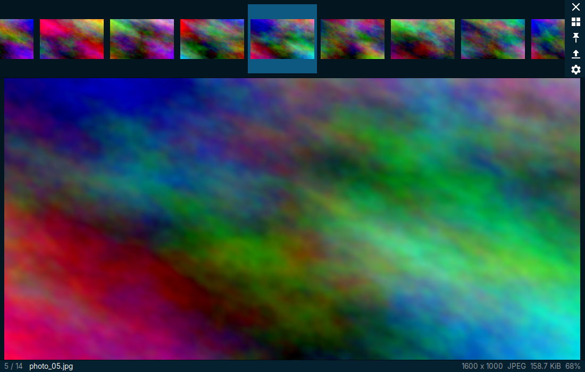
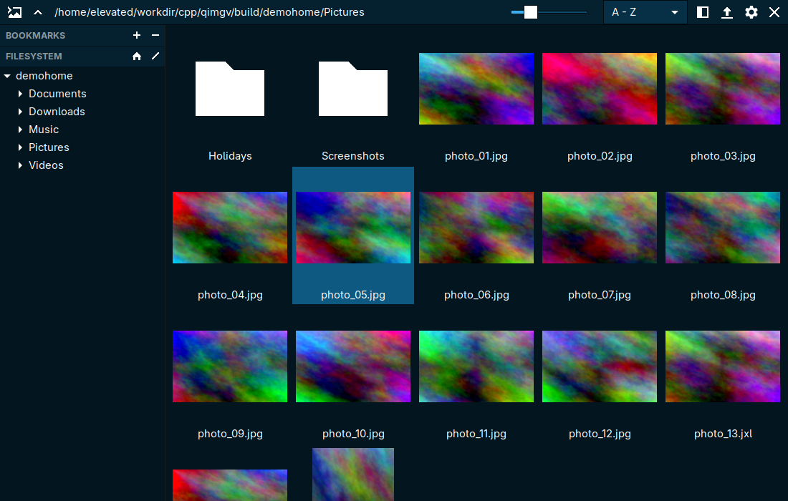
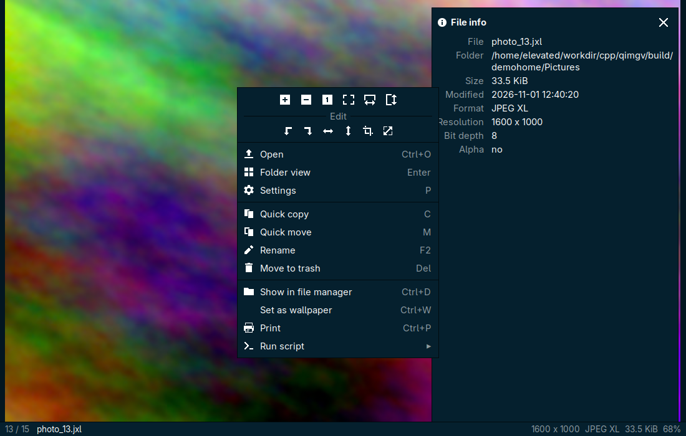

# qimgv-gtk

 [](https://aur.archlinux.org/packages/qimgv-gtk-bin) [](https://aur.archlinux.org/packages/qimgv-gtk-git)

<p align="center"></p>

A fast image viewer for Linux, written in C++ with GTK 3. It rewrites [qimgv][upstream] (Qt) and keeps the
same interface and keyboard workflow. It adds native JPEG XL, AVIF, HEIF, APNG and camera RAW support and drops
video playback.



| Folder view | Context menu and file info |
|---|---|
|  |  |

## Features

- **Same workflow as qimgv**: thumbnail panel that slides in at the window edge, folder view with bookmarks
  and a filesystem tree, an in-window context menu, an info bar, and the same default shortcuts.
- **Native decoders** for JPEG (libjpeg-turbo), PNG/APNG (libpng), GIF (giflib), WebP (libwebp), JPEG XL
  (libjxl), AVIF (libavif), HEIF/HEIC (libheif) and camera RAW (LibRaw). Everything else gdk-pixbuf can read
  is supported too (BMP, TIFF, SVG, ICO, TGA, QOI, …).
- **Animations**: GIF, APNG, animated WebP, JPEG XL and AVIF sequences.
- **No video**: video files are skipped when browsing a folder. Opening one shows a message instead.
- **High quality scaling**: box-filtered downscaling on a worker thread, so zooming stays responsive. A 20 MP
  NEF decodes in about 0.6 s.
- **Editing**: rotate, flip, crop (with aspect presets), resize. Saves JPEG, PNG, WebP, JPEG XL and AVIF and
  keeps EXIF metadata.
- **Quick copy / move** to 9 folders with <kbd>C</kbd> / <kbd>M</kbd> then <kbd>1</kbd>–<kbd>9</kbd>.
- **Follows the GTK theme**: all colours come from the GTK theme (pywal themes included). Icons are recoloured
  to the theme's text colour. Corners are square and windows have no title bar.

## Supported formats

| Format | Extensions | Decoder | Animation | Save |
|---|---|---|---|---|
| JPEG | jpg jpeg jpe jfif | libjpeg-turbo | – | yes |
| PNG / APNG | png apng | libpng | APNG | PNG |
| GIF | gif | giflib | yes | – |
| WebP | webp | libwebp | yes | yes |
| JPEG XL | jxl | libjxl | yes | yes |
| AVIF | avif avifs | libavif | yes | yes |
| HEIF / HEIC | heif heic heics hif | libheif | – | – |
| Camera RAW | dng nef cr2 cr3 arw raf orf rw2 pef srw x3f … (38 extensions) | LibRaw | – | – |
| Others | bmp tif tiff svg ico tga qoi pnm xpm dds exr icns … | gdk-pixbuf | – | – |

The decoder is picked from the file header, so files with the wrong extension still open. EXIF orientation
is applied. RAW files are developed with the camera white balance. **Settings → Advanced** can switch to the
embedded JPEG preview, which is faster.

## Installation

### Arch Linux (AUR)

| Package | Description |
|---|---|
| [`qimgv-gtk-bin`](https://aur.archlinux.org/packages/qimgv-gtk-bin) | Prebuilt x86_64 binary from the GitHub release |
| [`qimgv-gtk-git`](https://aur.archlinux.org/packages/qimgv-gtk-git) | Built from the latest commit |

```sh
paru -S qimgv-gtk-bin   # or qimgv-gtk-git
```

The binary, desktop file and icon are all named `qimgv`, so both packages conflict with the Qt `qimgv`
package.

### Release tarball

Each [release][releases] has `qimgv-gtk-<version>-linux-x86_64.tar.gz`, built on Arch Linux. It contains
`bin/qimgv` and `share/` (desktop file, metainfo, icons). It needs the libraries listed under Building at the
versions current Arch ships.

```sh
tar -xzf qimgv-gtk-0.1.0-linux-x86_64.tar.gz
sudo cp -r qimgv-gtk-0.1.0-linux-x86_64/{bin,share} /usr/local/
```

## Building

Requirements: a C++17 compiler, CMake 3.16+, GTK 3.24, libjpeg-turbo 3, libpng, libwebp, libjxl 0.9+,
libavif 1.0+, libheif 1.16+, LibRaw 0.21+, exiv2 0.28+, giflib and zlib.

```sh
# Arch
sudo pacman -S --needed base-devel cmake gtk3 libjpeg-turbo libpng libwebp libjxl libavif libheif libraw exiv2 giflib
# Fedora
sudo dnf install gcc-c++ cmake gtk3-devel turbojpeg-devel libpng-devel libwebp-devel libjxl-devel libavif-devel \
  libheif-devel LibRaw-devel exiv2-devel giflib-devel
```

```sh
cmake -S . -B build -G Ninja -DCMAKE_BUILD_TYPE=Release
cmake --build build
sudo cmake --install build
```

This installs `qimgv`, `qimgv.desktop` (registered for all supported image MIME types, so file managers offer
it under **Open With**), the AppStream metainfo and the icons. `-DQIMGV_BUILD_TESTS=OFF` skips the
`qimgv-decode-test` tool. `tests/run-decode-tests.sh build` generates a sample of every format (needs
ImageMagick, cjxl, avifenc, heif-enc and ffmpeg) and decodes them.

## Usage

```sh
qimgv photo.jxl          # open an image, the rest of its folder is browsable
qimgv ~/Pictures         # open a folder
qimgv --gen-thumbs ~/Pictures --gen-thumbs-size 160   # pre-generate the thumbnail cache, no display needed
```

```text
$ qimgv --help
Usage:
  qimgv [OPTION…] [FILE|DIRECTORY] - image viewer

Application Options:
  -v, --version              Show version and exit
  --gen-thumbs=DIR           Generate all thumbnails for a directory
  --gen-thumbs-size=SIZE     Thumbnail size for --gen-thumbs (default 128)
```

Move the pointer to the top edge to pull down the thumbnail panel. Its buttons are exit, folder view, pin,
open and settings. Right click opens the context menu.

### Default controls

| Action | Shortcut |
|---|---|
| Next / previous image | <kbd>→</kbd> / <kbd>←</kbd>, mouse wheel, mouse back / forward buttons |
| First / last image | <kbd>Home</kbd> / <kbd>End</kbd> |
| Next / previous folder | <kbd>Shift</kbd>+<kbd>→</kbd> / <kbd>Shift</kbd>+<kbd>←</kbd> |
| Zoom in / out | <kbd>Ctrl</kbd>+wheel, <kbd>Ctrl</kbd>+<kbd>↑</kbd> / <kbd>↓</kbd>, <kbd>+</kbd> / <kbd>-</kbd>, hold right button and drag up / down |
| Fit window / fit width / 1:1 / stretch | <kbd>1</kbd> / <kbd>2</kbd> / <kbd>3</kbd> / <kbd>4</kbd> |
| Switch fit modes | <kbd>Space</kbd> |
| Fullscreen | <kbd>F</kbd>, <kbd>F11</kbd>, double click |
| Exit fullscreen / exit | <kbd>Esc</kbd> |
| Exit | <kbd>Ctrl</kbd>+<kbd>Q</kbd>, <kbd>Alt</kbd>+<kbd>X</kbd>, middle click |
| Folder view | <kbd>Enter</kbd> / <kbd>Backspace</kbd> |
| Image info (EXIF) | <kbd>I</kbd> |
| Crop / resize | <kbd>X</kbd> / <kbd>R</kbd> |
| Rotate left / right | <kbd>Ctrl</kbd>+<kbd>L</kbd> / <kbd>Ctrl</kbd>+<kbd>R</kbd> |
| Flip horizontal / vertical | <kbd>H</kbd> / <kbd>V</kbd> |
| Save / save as / discard edits | <kbd>Ctrl</kbd>+<kbd>S</kbd> / <kbd>Ctrl</kbd>+<kbd>Shift</kbd>+<kbd>S</kbd> / <kbd>Ctrl</kbd>+<kbd>Z</kbd> |
| Quick copy / quick move | <kbd>C</kbd> / <kbd>M</kbd>, then <kbd>1</kbd>–<kbd>9</kbd> |
| Move to trash / delete | <kbd>Del</kbd> / <kbd>Shift</kbd>+<kbd>Del</kbd> |
| Rename | <kbd>F2</kbd> |
| Copy file / path to clipboard, paste | <kbd>Ctrl</kbd>+<kbd>C</kbd> / <kbd>Ctrl</kbd>+<kbd>Shift</kbd>+<kbd>C</kbd>, <kbd>Ctrl</kbd>+<kbd>V</kbd> |
| Show in file manager | <kbd>Ctrl</kbd>+<kbd>D</kbd> |
| Slideshow / shuffle | <kbd>`</kbd> / <kbd>Ctrl</kbd>+<kbd>`</kbd> |
| Set as wallpaper | <kbd>Ctrl</kbd>+<kbd>W</kbd> |
| Print | <kbd>Ctrl</kbd>+<kbd>P</kbd> |
| Open / settings | <kbd>Ctrl</kbd>+<kbd>O</kbd> / <kbd>P</kbd> |

Every shortcut can be changed in **Settings → Controls**. Digit shortcuts also work on layouts where the
digit row needs <kbd>Shift</kbd> (Czech, French, …).

### Quick copy / move

Press <kbd>C</kbd> (copy) or <kbd>M</kbd> (move) to show the 9 destinations. Press <kbd>1</kbd>–<kbd>9</kbd>
or click a row to copy or move the current image there. Click the folder icon on a row to change its
destination. Press the same key again or <kbd>Esc</kbd> to close the panel.

### Scripts

Add a script in **Settings → Scripts**. It can be a shell command, where `%file%` is replaced with the image
path, or an executable script file that receives the path as `$1`:

```sh
gimp %file%
```

Run scripts from the context menu (**Run script**), or bind them to a key in **Settings → Controls**.

### Wallpaper

**Set as wallpaper** uses the first tool it finds: hyprpaper (via `hyprctl hyprpaper reload`), swww, KDE
Plasma, GNOME, XFCE or feh.

## Configuration

Settings live in `~/.config/qimgv/qimgv-gtk.conf` (a GKeyFile). It is written when you press **OK** / **Apply**
in the settings window and when qimgv exits. Thumbnails are cached in `~/.cache/qimgv/thumbnails`. Clear the
cache from **Settings → Advanced**.

The original Qt qimgv uses `~/.config/qimgv/qimgv.conf`. This version doesn't read or change that file.

## Differences from qimgv 1.0

- Video playback (libmpv) and the `player_mpv` plugin are removed. Videos are skipped instead of listed.
- JPEG XL, AVIF, HEIF, APNG and RAW are built in, not loaded from Qt image plugins.
- Colours come from the GTK theme instead of qimgv's theme editor. There are no translations yet.
- Linux only. The Windows and macOS code is gone.

## License

GPL-3.0-or-later, see [LICENSE](LICENSE). Based on [qimgv][upstream] by easymodo. The icons are from the
original project.

Changes per version are in [CHANGELOG.md](CHANGELOG.md).

[upstream]: https://github.com/easymodo/qimgv
[releases]: https://github.com/TheElevatedOne/qimgv-gtk/releases
